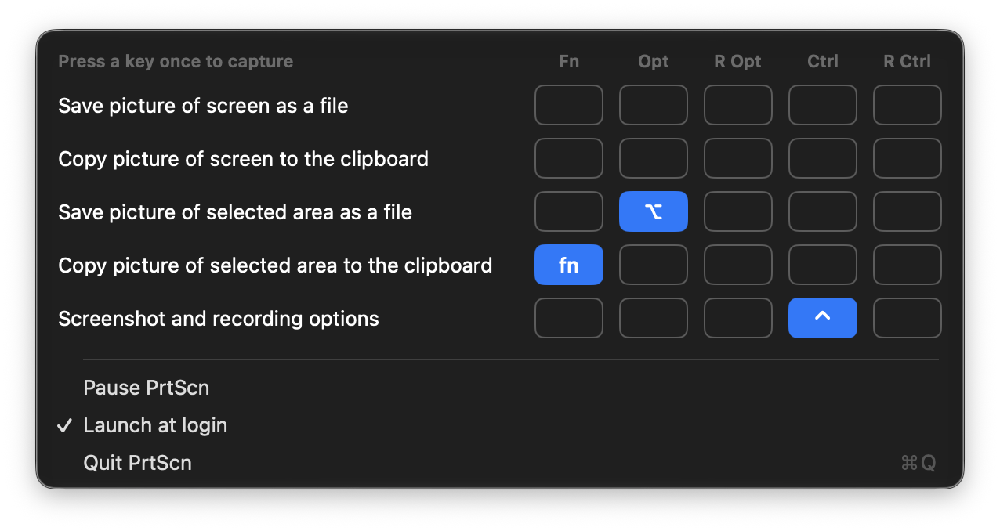

<p align="center">
  
</p>

<h1 align="center">PrtScn</h1>

<p align="center">
  <strong>One key, one screenshot.</strong><br>
  A tiny macOS menu bar app that takes a screenshot when you tap a single key.
</p>

<p align="center">
  
  
</p>

---

## How it works

Tap <kbd>🌐 fn</kbd>, or the left or right <kbd>⌃</kbd>, <kbd>⌥</kbd>, <kbd>⌘</kbd> or <kbd>⇧</kbd> on its own, and PrtScn runs the screenshot action you assigned to that key. It uses the built-in macOS `screencapture` tool, so files land where <kbd>⇧</kbd><kbd>⌘</kbd><kbd>3</kbd> puts them.

<p align="center">
  
</p>

Only a clean single press counts. Holding the key with anything else (another key, a modifier, a click, a scroll), or longer than a second, does nothing, so shortcuts like <kbd>⌥</kbd><kbd>⌘</kbd><kbd>X</kbd>, <kbd>fn</kbd><kbd>F1</kbd> or <kbd>⌃</kbd>-click keep working.

## Features

- **Five actions**: capture screen or area to file or clipboard, or **Record** (opens the macOS Screenshot toolbar)
- **Nine keys**: Fn / Globe, and left and right Control, Option, Command and Shift, each with its own action
- **Pause** without quitting
- **Launch at login**

## Setup

1. Build and run (see below). The icon appears in the menu bar.
2. Allow PrtScn in **Privacy & Security → Accessibility** and **Input Monitoring**, then restart it.
3. Allow **Screen Recording** when macOS asks on the first screenshot.
4. If you use Fn, set **System Settings → Keyboard → Press 🌐 key to** to **Do Nothing**.

## Building from source

Requires Xcode 27 (the app icon is an Icon Composer `.icon` file). No dependencies.

```sh
git clone https://github.com/gevgeny/PrtScn.git
cd PrtScn
open PrtScn.xcodeproj   # build & run the "PrtScn" scheme
```
