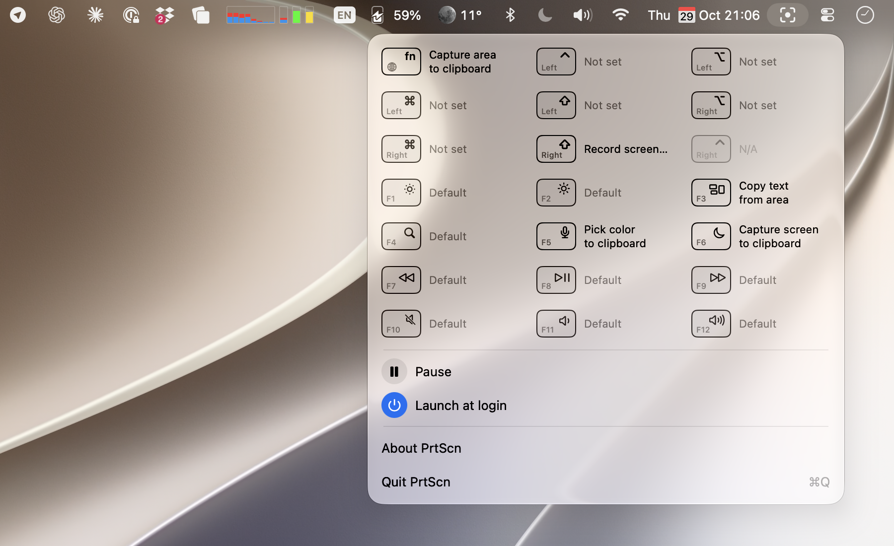

  

<h1 align="center">PrtScn</h1>

  <strong>One key, one screenshot.</strong> 
  A tiny macOS menu bar app that takes a screenshot when you tap a single key.

  
  
  
  

  <a href="./builds/PrtScn.0.1.3.zip"><strong>Download v0.1.3</strong></a> ·
  <a href="#features">Features</a> ·
  <a href="#permissions">Permissions</a>

---

## How it works

Tap <kbd>🌐 fn</kbd>, or the left or right <kbd>⌃</kbd>, <kbd>⌥</kbd>, <kbd>⌘</kbd> or <kbd>⇧</kbd> on its own, and PrtScn runs the screenshot action you assigned to that key. It uses the built-in macOS `screencapture` tool, so files land where <kbd>⇧</kbd><kbd>⌘</kbd><kbd>3</kbd> puts them.

  <picture>
    <source media="(prefers-color-scheme: dark)" srcset="docs/menu-dark.png">
    
  </picture>

Only a clean single press counts. Holding the key with anything else (another key, a modifier, a click, a scroll), or longer than a second, does nothing, so shortcuts like <kbd>⌥</kbd><kbd>⌘</kbd><kbd>X</kbd>, <kbd>fn</kbd><kbd>F1</kbd> or <kbd>⌃</kbd>-click keep working.

## Features

- **Eight actions**: capture screen or area to file or clipboard, **Capture area & edit** (opens the Markup editor), **Copy text from area** (on-device OCR), **Pick color** (copies `#RRGGBB`), or **Record** (opens the macOS Screenshot toolbar)
- **Nine keys**: Fn / Globe, and left and right Control, Option, Command and Shift, each with its own action
- **Pause** without quitting
- **Launch at login**

## Permissions

| Permission | Why |
|---|---|
| **Input Monitoring** | Notice single key presses, including 🌐 fn. Asked when you assign your first key; listen-only, keys are never blocked or changed |
| **Screen Recording** | Take screenshots; macOS asks on the first capture |

Grant them in **System Settings → Privacy & Security**; no restart needed. If you use fn, also set **System Settings → Keyboard → Press 🌐 key to** to **Do Nothing**.

## Support

PrtScn is free. If it saves you a few keystrokes, you can [buy me a coffee](https://buymeacoffee.com/eugene.g) ☕. Bugs and ideas: [open an issue](https://github.com/gevgeny/PrtScn/issues).
